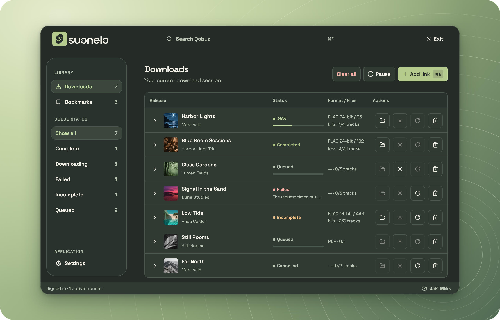
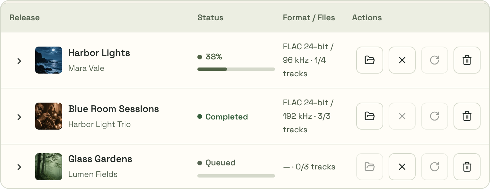
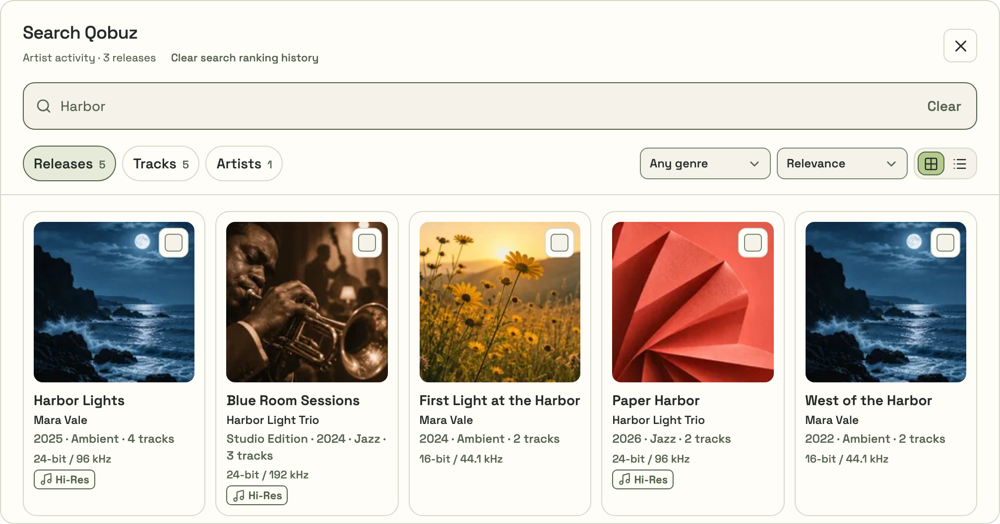
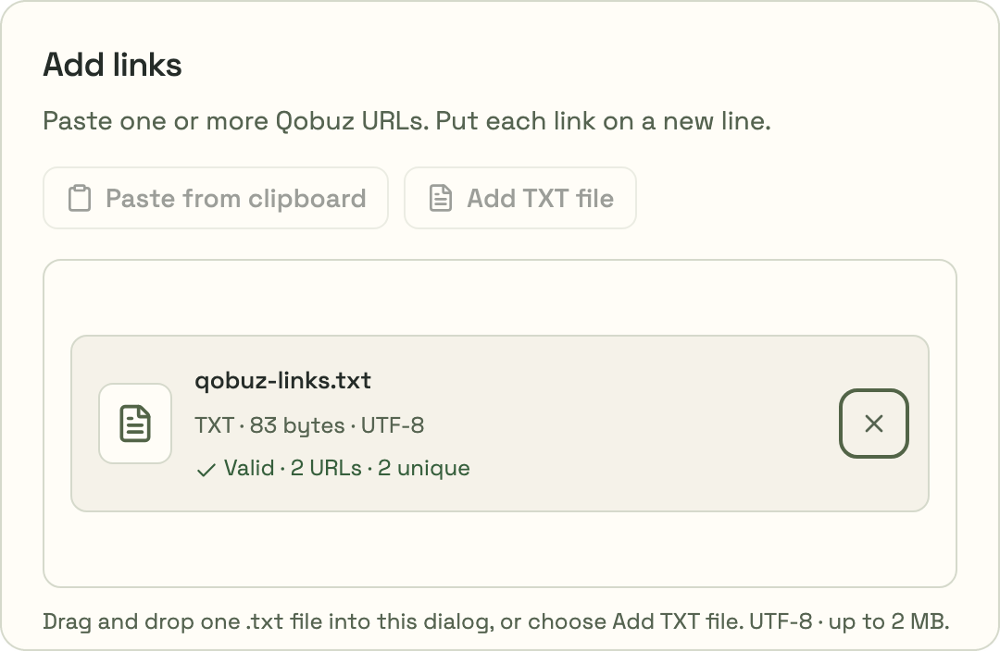
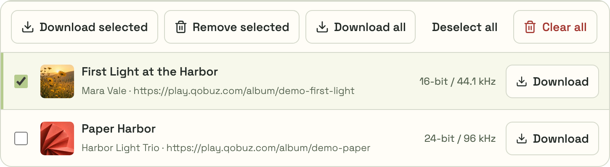
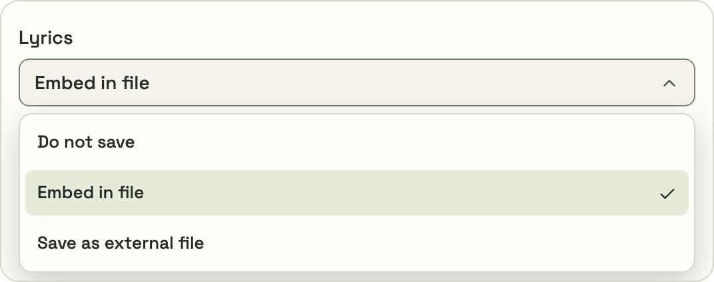
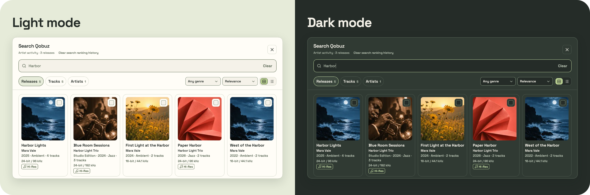

<p align="center"></p>

<p align="center"></p>

Suonelo is a desktop app for browsing Qobuz and saving music to your computer. Search for an album, set a few releases aside for later, or queue a whole list of links at once. Connect your Qobuz account to get started. Full-track downloads require an eligible account.

[GitHub Releases](https://github.com/arceenic/suonelo/releases) · [Changelog](docs/CHANGELOG.md) · [Build from source](#build-from-source)

## What you can do

The screenshots use sample releases. Open any feature image for its SVG version.

### Download from Qobuz

Save tracks, albums, and playlists in the quality available to your account, including lossless FLAC. You can pause the queue and retry failed downloads.

<a href="docs/images/qobuz-downloads.svg"></a>

### Search the catalog in the app

Find releases, individual tracks, and artists without leaving Suonelo. Filter by genre and choose what to download or bookmark.

<a href="docs/images/catalog-search.svg"></a>

### Queue a batch from a TXT file

Drop in a UTF-8 `.txt` file with one Qobuz link per line to queue the whole list at once.

<a href="docs/images/batch-import.svg"></a>

### Bookmark a release for later

Save releases and tracks as you browse, then download them individually or all together when you’re ready.

<a href="docs/images/bookmarks.svg"></a>

### Save lyrics with your music

When LRCLIB has a match, embed the lyrics in the audio file or save them alongside the track as `.lrc` or plain text.

<a href="docs/images/lyrics.svg"></a>

## Light and dark mode

Pick a mode in **Settings → Appearance**, or let Suonelo follow your system setting.



## System requirements

These are practical starting points for running the app. RAM, free space, and download speeds are planning estimates.

| | Minimum | Recommended |
| --- | --- | --- |
| **Windows** | Windows 10 22H2 | Windows 11 |
| **macOS** | macOS 13 Ventura | A current macOS release |
| **Linux** | x86-64 Linux with a graphical session, glibc 2.34 or later, GTK 3, WebKitGTK 4.1, and D-Bus. Sign-in requires a Secret Service provider. | Ubuntu 22.04 LTS with GNOME Keyring |
| **CPU** | Windows and Linux x86-64. Mac Intel x64 or Apple silicon (ARM64). | Native build for your CPU |
| **System RAM** | 4 GB | 8 GB or more |
| **Free storage** | 1 GB | 10 GB or more for your music |
| **Download speed** | Around 5 Mbps | 25 Mbps or faster for hi-res batches |

On Linux, install the x86-64 `.deb` from GitHub Releases with `sudo apt install ./suonelo-1.0.##-linux-x86_64.deb`. The package declares the desktop runtime dependencies and recommends GNOME Keyring. Other Secret Service providers can work with an encrypted session and a persistent default collection. If access is interrupted, unlock or start the keyring and choose **Retry keyring access**.

Linux stores the profile in `$XDG_DATA_HOME/com.suonelo.desktop`, normally `~/.local/share/com.suonelo.desktop`. A persistent Secret Service collection holds the credentials for that profile. Launch with `--qa-profile=NAME` to use a separate profile and keyring item. Existing experimental Linux data beside a previously built executable stays in its original location. Package removal leaves the profile and keyring item available for reinstall.

## Build from source

Install Git, Node.js 20.9 or later (CI uses Node.js 24), and Rust 1.99.1 via `rustup`. Clone the repo and run the commands for your platform from its root. [Tauri setup guide](https://v2.tauri.app/start/prerequisites/)

```sh
git clone https://github.com/arceenic/suonelo.git
cd suonelo
```

### Windows x64

Install PowerShell 7 and Visual Studio Build Tools with **Desktop development with C++** and the Windows SDK. Then run this in PowerShell.

```powershell
rustup target add x86_64-pc-windows-msvc
pwsh -File build-portable.ps1 -OutputRoot src-tauri/target/my-candidate
```

The script builds the portable ZIP and a SHA-256 checksum in the output folder. Pick a fresh output folder for each build.

### macOS

Install the Xcode Command Line Tools with `xcode-select --install` if needed. Open a native Terminal session with Node and Rust built for your Mac’s CPU.

```sh
# Apple silicon
rustup target add aarch64-apple-darwin

# Intel
rustup target add x86_64-apple-darwin
```

Run only the target command for your Mac, then build the app.

```sh
bash scripts/build-macos.sh --app
```

The script builds and tests the app and writes a locally signed `suonelo.app` to `src-tauri/target/<rust-target>/release/bundle/macos/`.

### Linux x86-64

On Ubuntu 22.04, install the native Tauri and packaging tools, then run the build script.

```sh
sudo apt install build-essential libwebkit2gtk-4.1-dev libxdo-dev \
  libayatana-appindicator3-dev libdbus-1-dev librsvg2-dev desktop-file-utils \
  binutils patchelf file python3
bash scripts/build-linux.sh
```

Find the `.deb`, executable `.AppImage`, and `SHA256SUMS.txt` in `suonelo-1.0.##-linux-x86_64/` at the project root. Rebuilding the same version creates a numbered folder alongside it.

## Backup the source

Run `python scripts/backup-source.py` with Python 3.10 or later on Linux, macOS, or Windows. The script saves a timestamped `.tar.gz` and SHA-256 checksum under `.agent-backups/`. It includes source, lockfiles, assets, and non-planning documentation. It checks the archive by restoring it to a temporary directory and comparing file hashes. Use `--include-plans` for a full pre-edit snapshot or `--exclude 'path/*'` to omit additional files. Use `--project` and `--output` to select another project or destination.


## Disclaimer

Suonelo is an independent project. It has no affiliation with Qobuz and carries no endorsement or sponsorship from Qobuz. Use it only for content you’re authorized to download and follow Qobuz’s terms and applicable law. The software is provided as is. To the extent permitted by law, the repository owner and contributors disclaim warranties and liability for claims, damages, or losses arising from use of the software.
